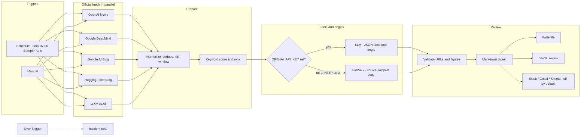

# AI Tech Watch

**An n8n workflow that turns official AI announcements into fact-checked post ideas — and refuses to invent a figure.**

Every morning (or on demand), my AI agent reads a small set of **primary sources**, keeps only what was published in the last 48 hours, scores it, and drafts a digest for **human review**. If an idea has no source URL, or uses a number that is not in the source text, it is rejected. Nothing is published automatically.

A worked example of the output this process is meant to support — seven sourced LinkedIn / X ideas from 24 November 2026 — lives in [`examples/2026-11-24-tech-post-ideas.md`](examples/2026-11-24-tech-post-ideas.md). A digest from a real run of this workflow is in [`examples/sample-output.md`](examples/sample-output.md).

> French version: [README.fr.md](README.fr.md)

## What my AI agent does

1. **Watches official feeds**, not aggregators: OpenAI News, Google DeepMind, the Google AI Blog, the Hugging Face Blog, and arXiv cs.AI.
2. **Normalizes and dedupes** by canonical URL, then drops anything older than 48 hours.
3. **Scores** items with a transparent keyword list. Official blog posts in the window are kept; arXiv papers must clear a minimum score and are capped, so the digest stays readable.
4. **Extracts verifiable facts** and proposes one post angle. When an OpenAI-compatible API key is present, an LLM does this and is forced to return JSON and to reuse the original source URL. When the key is missing or the call fails, the workflow still builds a digest from titles and source snippets.
5. **Validates, then stops for a human.** Every surviving idea is flagged `needs_review`. A human decides what, if anything, is published.

## Architecture



Feed requests **retry** and **continue on failure**. One broken feed must never wipe the run. The LLM HTTP node behaves the same way: a failed call falls back to a source-only digest instead of failing closed on the whole job.

## Node-by-node

| Section | Nodes | What they do |
| --- | --- | --- |
| 1. Triggers | `Trigger · Schedule (daily 07:00 Paris)`, `Trigger · Manual` | Start the same path, on a clock or on demand. Timezone: Europe/Paris. |
| 2. Official feeds | five `RSS · …` nodes, five `Tag · …` nodes, `Merge · All feeds` | Fetch the five feeds in parallel, stamp each item with its source name and feed URL, then append everything into one stream. |
| 3. Normalize and score | `Code · Normalize, dedupe & 48h window`, `Code · Keyword score & rank` | Canonicalize URLs, drop undated or stale items, dedupe, score, cap arXiv. |
| 4. LLM with fallback | `Code · Prepare LLM request`, `IF · LLM credential present`, `HTTP · LLM extract facts & angles`, `NoOp · Skip LLM`, `Merge · LLM or fallback`, `Code · Parse LLM or fallback` | One JSON chat-completions request when a key is set; otherwise (or on error) copy short facts from the source text. |
| 5. Validate and write | `Code · Validate sources & figures`, `Code · Build Markdown digest`, `Convert · Digest to file`, `Write · Digest to disk` | Reject unsourced or numerically unfaithful ideas, write a digest, keep a file on disk. |
| 6. Human review | `IF · Notifications enabled`, `NoOp · Notifications off`, optional Slack / Gmail / Sheets | Every idea is `needs_review`. Optional notifications stay off unless `ENABLE_NOTIFICATIONS=true` and placeholder credentials are replaced. |
| 7. Errors | `Error Trigger`, `Code · Format error report`, convert + write | Unhandled failures become an incident note. Set this workflow as its own *Error workflow* in n8n Settings. |

The Code-node scripts live in [`workflow/src/`](workflow/src/) and are assembled into [`workflow/ai-tech-watch.json`](workflow/ai-tech-watch.json) by [`workflow/src/build_workflow.py`](workflow/src/build_workflow.py). Sticky notes on the canvas document the same seven sections.

## Guardrails

- **Primary sources only.** The five feed URLs in the workflow were checked live before being pinned. There is no unofficial news scraper in the path.
- **No invented figures.** The validator extracts numbers from facts and angles and rejects any number that does not appear in the source title, snippet, URL or date.
- **The source URL is mandatory.** An idea whose `source_url` is missing, or does not match a fetched item, is rejected.
- **Human approval is the last step.** The digest is flagged `needs_review`. This workflow does not post to LinkedIn or X, and it does not send Slack, email or Sheets updates unless you deliberately turn that on.
- **Fail open on feeds, fail safe on facts.** A down feed is recorded in the digest's health table. A sloppy idea is dropped, not published.

## How to import into n8n

You need Node.js 18+ and the n8n CLI (this workflow was imported and executed on **n8n 2.49.6**).

```bash
npm i -g n8n
# or use a local install and point N8N_BIN at it

n8n import:workflow --input=workflow/ai-tech-watch.json
n8n list:workflow
```

Then open the n8n editor (`n8n start`), open **AI Tech Watch — official feeds to fact-checked post ideas**, and in **Workflow Settings**:

1. Confirm the timezone is `Europe/Paris`.
2. Set **Error workflow** to this same workflow, so the Error Trigger receives unhandled failures.
3. Leave the workflow **inactive** until you want the 07:00 schedule to fire. A manual run does not require activation.

Rebuild the JSON after editing a Code-node script:

```bash
python3 workflow/src/build_workflow.py
```

## Credentials and environment

| Name | Required? | Purpose |
| --- | --- | --- |
| `OPENAI_API_KEY` | No | When set, the HTTP node calls `$OPENAI_BASE_URL/chat/completions` (default: the OpenAI API). When unset, the fallback path still produces a digest. |
| `OPENAI_BASE_URL` | No | Override for a compatible endpoint. Default: `https://api.openai.com/v1`. |
| `OPENAI_MODEL` | No | Default: `gpt-4o-mini`. |
| `LOOKBACK_HOURS` | No | Default: `48`. |
| `DIGEST_PATH` | No | Where the Markdown file is written. Default: `/tmp/ai-tech-watch-digest.md`. |
| `ENABLE_NOTIFICATIONS` | No | Must be the string `true` to reach Slack, Gmail or Sheets. Default: off. |
| Slack / Gmail / Google Sheets credentials | Only if notifications are on | The workflow JSON contains **placeholder** credential IDs. Replace them in the n8n UI before enabling notifications. |

Copy [`.env.example`](.env.example) to `.env` for local experiments. Do not commit secrets. The HTTP node reads the API key from the environment; no key is stored in the workflow file.

## How to run

**In the n8n editor:** open the workflow and click **Test workflow** (this uses `Trigger · Manual`).

**From the CLI** (after import). In n8n 2.49 the `--file` flag is no longer supported; import first, then execute by id:

```bash
# Needed if you want Code nodes to read OPENAI_API_KEY, LOOKBACK_HOURS, DIGEST_PATH, …
export N8N_BLOCK_ENV_ACCESS_IN_NODE=false

# n8n 2.x only writes files under N8N_RESTRICT_FILE_ACCESS_TO (default: ~/.n8n-files)
export N8N_RESTRICT_FILE_ACCESS_TO="$HOME/.n8n-files;/tmp"
export DIGEST_PATH="/tmp/ai-tech-watch-digest.md"

n8n list:workflow
n8n execute --id=<workflow-id>
```

A convenience wrapper that sets those variables and imports the JSON:

```bash
# optional: export OPENAI_API_KEY=...
./scripts/run-once.sh
```

The Code nodes can also be checked without n8n:

```bash
node workflow/src/test_code_nodes.js
node workflow/src/test_code_nodes.js --live   # hits the five official feeds
```

## Sample output

See [`examples/sample-output.md`](examples/sample-output.md) for a digest produced by an actual n8n 2.49.6 execution of this workflow, on 26 November 2026 at 00:22 Europe/Paris. All five feeds responded. The run ingested 2,914 items, kept 458 in the 48-hour window, proposed 16 ideas, and rejected none. No API key was set, so the LLM step was skipped and facts were taken from source titles and snippets only. Every item is flagged `needs_review`.

The 24 November 2026 editorial pack in [`examples/2026-11-24-tech-post-ideas.md`](examples/2026-11-24-tech-post-ideas.md) is a finished, source-linked set of post drafts produced with the same rules: official links, no invented figures, nothing published without a human go-ahead.

## Repository layout

```
workflow/ai-tech-watch.json      # import this into n8n
workflow/src/                    # Code-node sources + builder + tests
examples/sample-output.md        # digest from a real n8n run
examples/2026-11-24-tech-post-ideas.md
scripts/run-once.sh
.env.example
```

## What this does not do

- It does not publish, schedule, or auto-reply on LinkedIn or X.
- It does not scrape unofficial recap sites.
- It does not treat an LLM sentence as a fact until the validator (and then a human) has seen it.
- It does not enable Slack, Gmail or Sheets unless you set credentials and `ENABLE_NOTIFICATIONS=true`.
